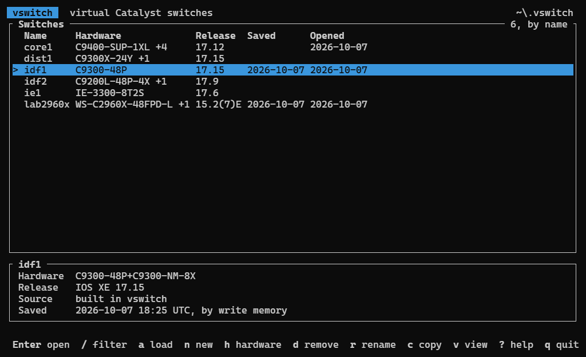
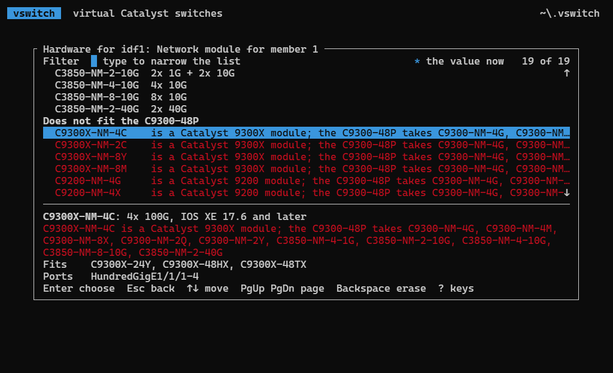
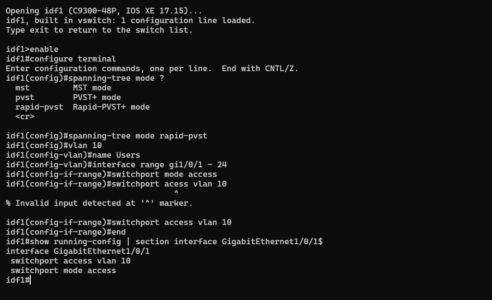
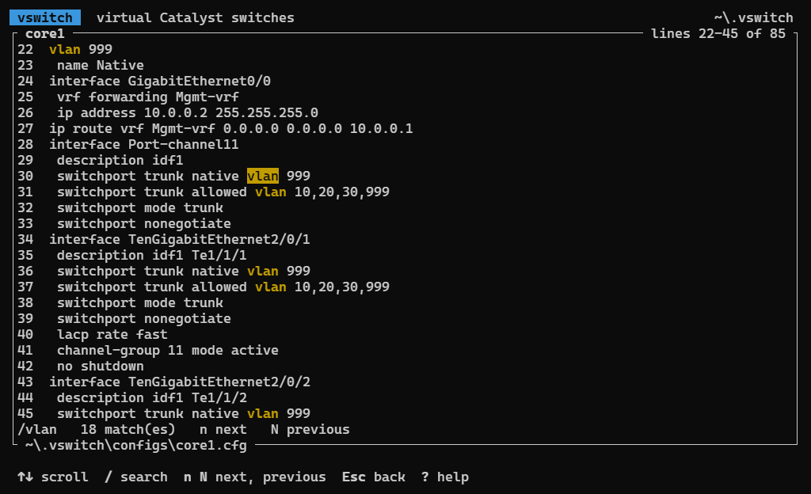

# virtual-switches

Virtual Cisco Catalyst 9300, 9200 and 9400 switches as one self-contained binary: an IOS XE command line whose commands follow Cisco's documentation for the platform and the release each switch runs, for writing and testing switch configurations without hardware.

| | |
|---|---|
| Releases | every IOS XE release Cisco publishes a command reference for: 9300 16.5, 16.6, 16.8 to 16.12, 17.1 to 17.18 and 26.x; 9200 16.9 to 16.12, 17.1 to 17.18 and 26.x; 9400 16.6, 16.9 to 16.12, 17.1 to 17.18 and 26.x. Classic IOS for the Catalyst 2960-X: the 15.2(2)E, 15.2(4)E, 15.2(6)E and 15.2(7)E trains. For the 2960, 2960-Plus and 2960-C: 12.2(44)SE, 12.2(55)SE, 15.0(2)SE, 15.2(2)E and 15.2(4)E; a train past the last book of its line reads that book (a 2960-Plus at 15.2(6)E1 reads 15.2(4)E, which Cisco titles "and later"). The Catalyst IE3300: 17.6, the train its captures run (Grammars, below). The Cisco IE 3000: 12.2(50)SE, 12.2(52)SE, 12.2(55)SE, 12.2(58)SE, 15.0(2)SE, 15.0(2)EY and 15.2(2)E. The Cisco IE 3010: 12.2(53)EZ, 15.0(2)SE and 15.2(2)E. A rebuild (`15.2(6)E1`) runs its train's book; a classic configuration's `version 15.2` line, which names no train, the newest 15.2 one. 17.15 when a switch names none (Cisco's recommended releases for every 9300 and 9200 model: 17.15.6 and 17.18.4) |
| Catalyst 9300X | C9300X-24Y, -12Y, -48TX, -24HX, -48HX, -48HXN; network modules C9300X-NM-2C, -NM-8Y, -NM-8M, and C9300X-NM-4C in the -24Y, -48TX and -48HX |
| Catalyst 9300 | C9300-24T, -48T, -24S, -48S, PoE+ -24P, -48P, UPOE -24U, -48U, -24UX, -48UXM, -48UN, UPOE+ -24H, -48H, and the B models C9300-24UB, -48UB, -24UXB; network modules C9300-NM-4G, -NM-4M, -NM-8X, -NM-2Q, -NM-2Y and C3850-NM-4-1G, -NM-2-10G, -NM-4-10G, -NM-8-10G, -NM-2-40G |
| Catalyst 9300L, 9300LM | C9300L-24T-4G, -48T-4G, -24T-4X, -48T-4X, PoE+ -24P-4G, -48P-4G, -24P-4X, -48P-4X, -48PF-4G, -48PF-4X, UPOE -24UXG-4X, -24UXG-2Q, -48UXG-4X, -48UXG-2Q; C9300LM-48T-4Y, UPOE -24U-4Y, -48U-4Y, -48UX-4Y; built-in uplinks |
| Catalyst 9200 | C9200-24T, -48T, PoE+ -24P, -48P, -48PL and the B models -24PB, -48PB (modules C9200-NM-4G, -NM-4X), PoE+ C9200-24PXG, -48PXG (modules C9200-NM-4X, -NM-2Y, -NM-2Q); C9200L-24T-4G, -48T-4G, -24T-4X, -48T-4X, PoE+ -24P-4G, -48P-4G, -24P-4X, -48P-4X, -48PL-4G, -48PL-4X, -24PXG-4X, -48PXG-4X, -24PXG-2Y, -48PXG-2Y with built-in uplinks |
| Catalyst 9400 | supervisors C9400-SUP-1, -SUP-1XL, -SUP-1XL-Y, C9400X-SUP-2, -SUP-2XL; line cards C9400-LC-24S, -48S, -24XS, -48XS, -24XY, -12QC, -48T, -48TX, -48U, -48P, -48H, -48UX, -48HN, -48HX. A card or supervisor is the member numbered by its slot (`3=C9400-SUP-1XL`) |
| Catalyst 2960-X | WS-C2960X-24TS-L, -48TS-L, -24TD-L, -48TD-L, -24TS-LL, -48TS-LL, PoE+ -24PS-L, -48LPS-L, -48FPS-L, -24PD-L, -48LPD-L, -48FPD-L, -24PSQ-L (data sheet), up to eight in a FlexStack-Plus stack; the LL models and the 24PSQ-L do not stack. The uplinks follow the front ports on slot 0 (`Gi1/0/25-28`, `Gi1/0/49-52`, `Te1/0/1-2`) and the management port is `FastEthernet0`, as a 24PS-L's running configuration names them |
| Catalyst IE3300 | IE-3300-8T2S (data sheet), one switch with no management port: SFP ports `GigabitEthernet1/1` and `1/2`, copper `1/3` to `1/10` |
| Cisco IE 3000, IE 3010 | IE-3000-8TC: copper `FastEthernet1/1` to `1/8` and dual-purpose uplinks `GigabitEthernet1/1` and `1/2`. IE-3010-16S-8PC: `FastEthernet0/1` to `0/16` SFP, `0/17` to `0/24` copper, uplinks `GigabitEthernet0/1` and `0/2` (data sheets, captures). One switch each, no management port; the IE-3010's PoE is not modelled |
| Catalyst 2960, 2960-Plus, 2960-C | WS-C2960-24TC-L, WS-C2960G-24TC-L, WS-C2960G-8TC-L, WS-C2960+24TC-L, WS-C2960C-8TC-L (data sheets), one switch each. Ports are named `<type>0/<port>` (`FastEthernet0/1`, `GigabitEthernet0/2`), the dual-purpose uplinks after the front ports, and there is no management port, as their running configurations name them. `--stack WS-C2960+24TC-L` reads the `+` as part of the model |
| PoE | each PoE model's kind (PoE+ 30 W a port, UPOE 60 W, UPOE+ 90 W) and the budget its default power supply gives (hardware installation guide, data sheet); a 9400 PoE card's kind only, as its chassis power supplies set the budget |
| Grammars | `data/grammars/<book>-<release>.json.gz`, one per platform book and release, compiled into the binary: the 9300 book for the 9300 models, the 9200 book for the 9200 and 9200L, the 9400 book for the 9400, the 2960-X book for the 2960-X, the 2960 book for the 2960, 2960-Plus and 2960-C. The 2960 books document the switch's own commands; a command a 2960 capture uses that its book refuses (`hostname`, `line`, `vlan`, `snmp-server host`) is taken from the 2960-X book of the same IOS, at its newest train not after the 2960's. Cisco publishes no IE3x00 command reference: the IE3300 book projects the 9300 grammar at the same release, keeping the commands its guides (the 17.1 configuration guide and the area guides) or its captures at that release name, then adds the guides' own steps and the overrides scoped to it. Its StackWise, stack power and network module commands are refused. The IE 3000 and IE 3010 books cover the switches' own commands and take general IOS commands from the 2960-X book as the 2960's do. Cisco retired the IE 3010's 12.2(53)EZ books: its configuration guide is read from the Wayback Machine (the May 2017 copies), and its commands are the IE 3010 15.0(2)SE command reference's as of 12.2(53)EZ: a command its Command History introduces in 15.0(2)SE is left out (34), and so is an alternative naming a keyword a later row adds (`ip access-group ... { in }`, without `out`) |
| Language | Rust |

Hardware Cisco does not build, stack or run is refused with the reason, from the data sheets and release notes:

| Rule | |
|---|---|
| Network modules | C9300X-NM modules fit only the 9300X, C9300-NM and C3850-NM modules only the 9300; C9200-NM-2Y and -NM-2Q fit only the C9200-24PXG and -48PXG, and C9200-NM-4G does not fit them; a model with built-in uplinks takes none |
| Stacks | the 9300X stacks with the 9300 (StackWise-480 when mixed), the 9300L with the 9300LM (StackWise-320); the 9200 and the 9200L each stack only with themselves, and the B models (C9300-24UB, -48UB, -24UXB; C9200-24PB, -48PB) only with B models of their series; 8 members at most, numbered 1 to 8 (a switch that does not stack is member 1) |
| Releases | a model or module runs from the release Cisco introduced it in (26.1 release notes): C9300-24T, -48T, -24P, -48P, -24U, -48U and the C9300-NM and C3850-NM modules 16.5 (C9300-NM-4M and -NM-2Y 16.8), C9300-24UX, -48UXM 16.6, C9300-48UN 16.8, C9300-24S, -48S and the C9300L 16.11, the C9300L-48PF and -UXG models and the B models 16.12, C9300-24H, -48H 17.2, C9300X-12Y, -24Y, -48TX, -48HX and their modules 17.5 (C9300X-NM-4C 17.6), C9300X-24HX, -48HXN and the C9300LM 17.9; C9200L 16.9, C9200-24T, -48T, -24P, -48P and C9200-NM-4G, -NM-4X 16.10, C9200L PXG models 16.11, C9200-24PXG, -48PXG and C9200-NM-2Y, -NM-2Q 17.1, C9200-24PB, -48PB 17.2, the PL models 17.3; C9400-SUP-1, -SUP-1XL, -LC-24XS, -48T, -48U, -48UX 16.6, C9400-LC-24S, -48S, -48P 16.8, C9400-SUP-1XL-Y 16.9, C9400-LC-48H 16.12, C9400-LC-48HN 17.5, C9400X-SUP-2, -SUP-2XL 17.7, C9400-LC-48XS, -48HX 17.8, C9400-LC-24XY, -12QC 17.12, C9400-LC-48TX 17.13 |
| Last release | the C9400-SUP-1, -SUP-1XL and -SUP-1XL-Y run up to 17.18 (26.1 release notes) |
| 9400 chassis | the supervisors' slots fix the chassis (data sheet): C9404R supervisors in 2 and 3, line cards in 1 and 4; C9407R supervisors 3 and 4, line cards 1, 2, 5 to 7; C9410R supervisors 5 and 6, line cards 1 to 4, 7 to 10. One or two supervisors, two of one model |
| 9400 uplinks | a supervisor's QSFP port runs once `enable` turns it on (`interface FortyGigabitEthernet3/0/9`, `enable`), which turns off the SFP ports it pairs with: on a Supervisor 1 ports 1-4 or port 9, ports 5-8 or port 10; on a Supervisor 2 ports 1-4 or port 5. With two supervisors a Supervisor 1's ports 5-8 and 10 and a Supervisor 2's ports 7 and 8 never run (Supervisor Module Installation Note). `generate` writes `enable` under a QSFP uplink a design uses and refuses the ports it turns off |

Ports are `<type><member>/0/<port>` and uplinks `<type><member>/1/<port>`. A 9300 member lists the whole uplink slot whatever module is fitted, as IOS does (`GigabitEthernet<n>/1/1-4`, `TenGigabitEthernet<n>/1/1-8`, `FortyGigabitEthernet<n>/1/1-2`, `TwentyFiveGigE<n>/1/1-2`), and `AppGigabitEthernet<n>/0/1`. Interfaces that carry no traffic are accepted, as IOS accepts them, and `generate` refuses a design that uses one: slot interfaces the fitted module does not use (the hardware installation guide's "Disregard" rows; the 10G ones of a 40G module carry a 4x10G breakout cable), ports 7 and 8 of a C9300X-NM-8Y or -NM-8M in a C9300X-48HXN, the ports a redundant 9400 supervisor pair does not run, and a single supervisor's ports beyond its uplink option. A 9400 supervisor's uplinks are `<type><slot>/0/<port>`. Port names Cisco's documents do not give are taken as follows, and `show` on the hardware settles them:

| Hardware | Taken as |
|---|---|
| C9200-24PXG, -48PXG, C9200L-24PXG-4X, -24PXG-2Y, -48PXG-2Y | the mGig ports are the last eight, `TenGigabitEthernet` |
| C9200L-48PXG-4X, C9300L-48UXG | the mGig ports are the last twelve, `TenGigabitEthernet` |
| C9300L-24UXG, C9300LM-48UX-4Y | the mGig ports are the last eight, `TenGigabitEthernet` |
| C9300X-48HXN | 1-40 `FiveGigabitEthernet`, 41-48 `TenGigabitEthernet` |
| C9400-SUP-1XL-Y | ports 1-8 `TwentyFiveGigE`, 9-10 `FortyGigabitEthernet` |
| C9400X-SUP-2, -SUP-2XL | ports 1-4 `TwentyFiveGigE`, 5-8 `HundredGigE` |
| C9400-LC-24XY | 1-20 `TwentyFiveGigE`, 21-24 `TenGigabitEthernet` |
| C9400-LC-12QC | 12 `FortyGigabitEthernet` |
| C9400-LC-48HN | `FiveGigabitEthernet` |

## Screens

The switch list, the hardware builder with its network module list open, a switch's console, and a kept configuration searched, at 100x30 in Windows Terminal's Campbell scheme. `cargo test --test terminal_audit screens -- --ignored` draws them again.









## Use

```
cargo build --release
target/release/vswitch
target/release/vswitch shell
target/release/vswitch run tests/example-draft.txt
target/release/vswitch explain config-if "spanning-tree portfast trunk"
```

| Command | |
|---|---|
| (none) | the switch list: the switches loaded before, by name; Enter opens the selected switch's console (below) with its configuration loaded, `write memory` there keeps its changes, `exit` comes back to the list |
| `load <design.toml or config> [--stack <members>] [--release <x.y>] [--replace]` | adds a switch to the list without opening it; a switch of the same name is replaced only with `--replace`, and named; a file saved as UTF-16 loads, and a file name with spaces names the switch with dashes |
| `sweep [<file or folder>...] [--out <folder>]` | removes passwords and secrets from configuration files and session logs, in place or into copies under `--out`; with no path, the sweep folder; exit 1 on a path that does not exist or a file left alone |
| `shell [--stack <members>] [--release <x.y>]` | a console from `Switch>`, on a switch kept nowhere |
| `generate <design.toml> [--release <x.y>] [--out <config>] [--show-run]` | a configuration from a design file (stack, VLANs, port-channels and members, management, services); the design is checked (trunks naming undefined VLANs or VLANs outside 1-4094, a port in two port-channels or written two ways, a port-channel written twice, `edge` or `lacp_fast` on an existing port-channel, `ssh_only` with no domain for the RSA key) and every line typed into the switch before anything is written; prints what each port-channel carries |
| `generate ... --change <change.txt>` | the change script from the design's `[change]` table: port table, notes, steps and checks before, the configuration to paste, checks after, rollback; every check command and rollback line is typed into the switch |
| `generate ... --running <capture> --target <target>` | the capture with the change applied as IOS prints it (lines in IOS order, allowed-VLAN lists resolved, a port-channel's switchport lines on its members); refused unless the rollback leads back to the capture line for line. Without `--running`, `--target` is the new switch's running configuration |
| `run <script> [--stack <members>] [--release <x.y>] [--quiet]` | types each line of a script at its prompt and prints the session; exit 1 when any line is refused |
| `explain <mode> <line> [--platform <book or model>] [--release <x.y>]` | the command a line matches, its source and syntax line, its modes and the mode it enters; `--platform` names a book (`9200`, `9400`, `2960x`, `2960`, `ie3300`, `ie3000`, `ie3010`) or a model (`IE-3000-8TC`), the 9300 otherwise |
| `examples [--show N] [--canonical] [--platform <book or model>] [--release <x.y>]` | types every example line of the release's documentation at its prompt and counts the outcomes |
| `check <config> --to <x.y> [--from <x.y>] [--stack <members>] [--all]` | types a configuration at the release it runs (its `version` line, or `--from`) and at `--to`, and lists the lines the change breaks, the lines it newly takes and those vswitch takes at neither, with the hardware `--to` does not run; exit 1 on a break or on hardware. A line taken at `--from` only because a real switch held it, which the `--to` books do not carry, is listed apart: no capture at `--to` says whether it breaks; lines one release does not reach are listed as not typed there. A classic `version 15.2` line names only a train, so such a configuration needs `--from`. The hardware comes from `--stack`, else the configuration's provision lines and interface names; a problem of the whole stack names no member |
| `changes <backup file or folder>... --captures <dir>` | what each backup changes on its captured switch (Captures, below); exit 1 on a new refusal or finding |
| `fleet <captures dir> --to <x.y>... [--all]` | every capture checked at the first `--to` release its book documents and its hardware runs (`--to 17.15 --to 15.2(7)E --to 15.0(2)SE` sends each family to its own): the lines each switch breaks, those only a capture at the target would prove, and the hardware the release does not run; worst first, with a count of switches that move clean and of captures it could not read or place, each named. Exit 1 when any breaks |
| `topology <captures dir> [--out <lab.toml>]` | a lab file of the captured switches cabled where both ends' port descriptions name each other (Linked switches, below), each at its newest capture |
| `lint <config> [--stack <members>] [--release <x.y>]` | types a configuration at the release it runs and checks it as it stands (below); exit 1 on a finding |
| `capture <user@host> [--key <file>]`, `capture --log <session log>... [--config <file>]`, `capture --folder <dir>`, each `[--out <dir>] [--pending <dir>]` | a real switch read over SSH, a terminal log of a session with one, or a folder of logs and backup files from many (below) |
| `probe <user@host> <script> --lab [--key <file>] [--out <dir>] [--skip-unsafe] [--map <from>=<to>]...` | a script typed on a private lab switch and compared with vswitch (below); exit 1 on a difference |
| `lab <lab.toml> [--shell <switch>]` | switches cabled together (below): each switch built from its files, each cable brought up from both ends and checked; exit 1 on a finding; `--shell` opens that switch's console with its links up |
| `releases` | the releases each book has a grammar for |
| `coverage [--all] [--baseline]` | in a build with a captures folder: every capture typed at its platform and release with the lines real switches held set aside: per book and release, the lines the books alone refuse under a line they take, and the commands refused most; `--all` lists each, `--baseline` writes the list the captures folder's `coverage.txt` holds, which a test compares |
| `corpus <captures dir> [--out <file>]` | what the captures teach, compiled into `data/corpus.json.gz` with every site value characterized; `--scan <dir>` lists each line under a folder that names the site, and exits 1 on one; with `--loose` also each word holding a site word of four or five characters, for a person to review; it also reads each crawl folder, `<book>-<release>/crawl` or `crawl-<name>` beside it, whose `level` file names a license level, for the `?` answers its `crawl.log` holds (Real switches, below); it prints each crawl read with its level, each crawl folder without a `level` file as not read, and how many answers it kept |
| `verify <config> [--stack <members>] [--release <x.y>]` | each line's evidence (below): held by a real switch of that platform and release, the same command in another form, or from the books only; the books-only lines printed under their block and section lines with the indentation they were typed with, banners whole, a script to type on such a switch. Here and in `capture`, `check`, `changes`, `fleet` and `topology` an option the command does not take is refused |
| `verify --outputs` | the output rules no real switch has shown yet |
| `compile ...`, `compile-releases ...` | rebuild the grammars (below) |

`<members>` lists the stack's models from member 1, each with an optional network module: `C9300X-24Y+C9300X-NM-4C,C9300X-24Y+C9300X-NM-4C` (the default).

## Releases

A switch runs one IOS XE release: `--release`, a design's `release = "17.9"`, or a configuration's `version 17.9` line, else 17.15 where its book documents it and the hardware runs it, else the newest release the book documents that the hardware runs (a plain 2960, 15.0(2)SE). A `--release` that disagrees with the file's own is refused. A patch release runs its train's book (`17.9.4` is 17.9) and any 26 release the 26.x book. Each release's grammar is compiled from that release's own books, so commands, keywords and modes follow what its documentation lists, and hardware newer than the release is refused. The switch list keeps each switch's release; a configuration loaded with a `version` line opens the builder at that release.

The switch refuses what IOS refuses, with IOS's messages: `% Invalid input detected at '^' marker.` with the caret past the longest start of the refused word that a keyword there begins with (`show config` at `>` is refused under the `f`: `controllers` begins `con`); a command `privilege exec level <n>` raises above 1 is refused at `>` and its `?` answers `% Unrecognized command`. `terminal length <0-512>` and `terminal width <0-512>` are taken at `>` and `#`, the width the one `show vlan brief` wraps to (0 for none), `% Incomplete command.`, `% Ambiguous command:`. An interface the stack does not have is refused at its name. Accepted configuration lines build the running configuration that `show running-config` prints.

## Switch list

Each row is a switch: its hostname, its hardware (the first member's model, a 9400's supervisor, and `+N` for the members besides), its release, and the dates `write memory` last saved it and its console was last opened, as many columns as the terminal fits. The selected switch's details stand beside the list from 110 columns and below it otherwise: its members and modules, its release with its system (IOS on the 2960, 2960-X, IE 3000 and IE 3010, IOS XE on the rest), the file it came from, where its configuration is kept, and when it was loaded, opened and saved. `?` lists the keys of the screen in use; the footer names the main ones.

| Key | |
|---|---|
| Up, Down, k, j | select a switch |
| PgUp, PgDn, Home, End | a page up or down, the first, the last |
| Enter | open its console; `exit` there comes back |
| / | filter by name, model or release as it is typed |
| Esc | clear the filter; with none, quit |
| a, Insert | load a design or a configuration from a file |
| n | a new switch: its hostname, then its hardware |
| h | its hardware and release in the builder |
| r | rename it; the configuration's hostname follows |
| c | copy it under another name |
| v | read its kept configuration |
| e | export its kept configuration to a file |
| d, Delete | remove it from the list, asked first |
| u | bring back the switch removed last |
| o | order by name or by last opened |
| s | sweep the sweep folder of secrets |
| ?, F1 | the keys of the screen in use |
| q, Ctrl-C | quit |

| Screen | |
|---|---|
| Console | the kept configuration typed in configuration mode, then `hostname>` as after boot; lines the virtual switch does not model are listed and skipped. `Opening <name> (<hardware>, <release>)...` prints as the grammar is read, and `<name>: <n> configuration lines loaded from <file>.` once the configuration is typed; a platform release's grammar is read once a run |
| Filter | each word typed must be in a switch's name, its members' models and modules, or its release: `9300 17.9` |
| File browser | the folder's entries, folders first, designs and configurations (`.toml`, `.cfg`, `.txt`, `.log`) bright and other files dim; typing narrows them, Tab completes, Enter opens a folder or loads a file, Backspace with nothing typed goes up a folder (above a drive, the drives). A typed or pasted path loads as it is, `~` being the home folder (paths in it are shown from `~`), and a path pasted or dropped on the list opens the browser with it. A design names its hardware; a configuration's is read from its `switch <n> provision` lines and interface names and confirmed in the builder before it is kept. Hardware vswitch does not know opens the builder with it named in red until a model is chosen, and a file with no `hostname`, `version`, `interface` or `vlan` line is not loaded. The browser opens in the folder last loaded from or exported to |
| Export | the browser with a file name, `<hostname>.cfg` offered; Enter writes it, and a file already there is written over only after `y` |
| Configuration | the kept configuration with line numbers, scrolled by line and page and sideways; `/` searches it ignoring case, `n` and `N` step through the matches, scrolling sideways to one past the edge |
| Name | one word, no other switch's; a rename or a copy rewrites the hostname line of the kept configuration, and a copy takes the hardware and release |

A switch loaded or built under a listed switch's name is kept only once that is confirmed: `y` replaces the listed switch, `k` keeps both under a name typed for the new one. Each removed switch comes back with `u`, the last removed first, until vswitch closes. Problems read red on the status line; completed saves, exports and hardware changes green; a hardware choice that changes nothing plain. The list takes no mouse input, so the terminal's own text selection and right-click paste keep working. A Windows console delivers a paste as keys: on the list, three or more typed keys read together are a paste and act as no command, unless the first opens a field to type into (`a`, `n`, `/`, `r`, `c`, `e`), which takes the rest as typed. A busy console types a paste in pieces, which the list gathers while each key comes pressed and released at once; a key held down acts as that key, repeated. A list command is a plain key: Alt with a letter does nothing. Ctrl-C over a popup or the builder cancels it as Esc does. A terminal smaller than 60 by 15 is told so and no key acts until it is larger; Ctrl-C quits.

The list lives in `%USERPROFILE%\.vswitch` on Windows (AppData is redirected per MSIX package, so a list written there from a packaged app is seen by that app alone) and `$XDG_DATA_HOME/vswitch` (else `~/.local/share/vswitch`) elsewhere, or `VSWITCH_HOME`: `switches.json`, a copy of each configuration under `configs/`, swept of secrets before it is kept, and `prefs.json`, the list's order and the browser's folder. A console's changes are kept by `write memory` or `copy running-config startup-config`, which save the running configuration into the list, swept as a load is; a changed hostname renames the switch unless another has that name. Without a save they last until `exit`, as on a switch reloaded without one.

## Console

The console reads keys as an IOS console does when its input is a terminal, and lines when it is a pipe or a file. The IOS editing keys are matched below; crossterm reports each Esc sequence as Alt+key or as Esc then the key, and both are taken. AltGr types its character.

| Key | |
|---|---|
| `?` | after a space, what may come next, each with its help, and `<cr>` when the line is complete; right after a word, the keywords it begins. The line stays as typed. Help longer than the page pauses at `--More--`, and a description wider than the terminal goes on under its column. In a banner's text, `?` and Tab are typed as text |
| Tab | completes the last word to the one keyword it begins among the keywords `?` lists for the line before it (a whole keyword is itself: `ip` with `ipv6` beside it; a held answer's keywords where one is held, a refusal's none, else the books') or to an interface type (`twe1/0/1` is `TwentyFiveGigE1/0/1`) |
| Up, Down (Ctrl-P, Ctrl-N) | the lines entered before, pasted lines included |
| Left, Right (Ctrl-B, Ctrl-F) | move one character; a line wider than the terminal scrolls, `$` marking the side that runs past the edge |
| Home, End (Ctrl-A, Ctrl-E) | to the start or end of the line |
| Esc B, Esc F | back or forward one word, a word being a run of letters and digits |
| Backspace, Delete (Ctrl-D) | delete the character before or at the cursor |
| Ctrl-K, Ctrl-U (Ctrl-X), Ctrl-W, Esc D | delete to the end, to the start, the word before, the word after |
| Ctrl-Y, Esc Y | recall the last deleted text, then step back through earlier deletions |
| Esc C, Esc L, Esc U | capitalize, lowercase or uppercase from the cursor to the word's end |
| Ctrl-T | transpose the two characters at the cursor |
| Ctrl-L, Ctrl-R | reprint the prompt and line on a fresh row |
| Ctrl-V, Esc Q | take the next key as itself, so `?` or Tab enters a line |
| Ctrl-Z | `end`: leaves configuration mode; at an EXEC prompt and in a banner's text it does nothing and the line stays |
| Ctrl-C | discard the line; in configuration mode, return to the EXEC prompt; in a banner's text, discard only the line being typed |

An impossible key, such as Left at the start of the line or Tab with several candidates, is a beep.

Output longer than the page pauses at `--More--`: Space shows the next page, Return the next line, q or any other key stops, `?` names the keys. `terminal length <n>` sets the page to n rows and `terminal length 0` turns paging off; `terminal width <n>` sets the width a long line wraps to; each takes 0 to 512, `terminal` by any unique start. Resizing the window sets both, unless `terminal length` or `terminal width` set them. Paging is for the interactive console; pipes, files and `run` scripts print whole. A pasted configuration is typed line by line, each entered and answered, the last partial line left to finish.

In a pipe, a file and a `run` script, a line ending in `?` prints the help for what precedes it and is not entered. `?` lists keywords, `WORD`, `LINE`, `<min-max>`, `A.B.C.D`, `X:X:X:X::X`, `H.H.H`, and where an interface goes the stack's interface types and the logical ones (Loopback, Port-channel, Tunnel, Vlan).

## Hardware builder

A stack member by member: its number (a 9400 card's is its slot), model and network module, then a 9400's chassis and the release it runs. The builder opens for `n`, `h`, and a configuration whose file does not name its hardware (filled in from its provision lines and interface names) or a design whose hardware Cisco does not build. Below the members it shows the selected one's ports as IOS names them, its uplinks, PoE kind and budget and the releases it runs, then the stack as `--stack` takes it.

| Key | |
|---|---|
| Up, Down (k, j) | select a member |
| Tab, Shift-Tab | the next or previous field: number or slot, model, network module, chassis (9400), release |
| Space, or typing | the field's list, filtered by what is typed |
| In a field's list | Up, Down, Left, Right, PgUp, PgDn, Home, End move; Enter chooses; Esc goes back; Tab goes on to the next field choosing nothing; `?` the keys |
| Left, Right | step the field: the models of the member's family (a 9400's supervisors and line cards apart), the modules the model takes, the free numbers, the chassis, the releases |
| `+`, Insert | add a member like the selected one; in a 9400 the lowest free slot the chassis takes it in |
| `-`, Delete | remove the selected member |
| `[`, `]` | the previous or next release the stack's book documents, going round past the oldest or newest, which the status line says |
| Enter | keep the hardware; while a problem is marked, select the member it names and say so |
| Esc | cancel |
| `?` | the keys |

| In a list | |
|---|---|
| Up, Down, PgUp, PgDn, Home, End | move |
| typing, Backspace, Ctrl-U | filter, erase, clear: every space-separated term matches, dashes ignored (`2960x48` finds WS-C2960X-48TS-L) |
| Enter | choose |
| Esc | close the list |

Models are listed by family, a 9400's supervisors and line cards apart, network modules that fit the model first, releases by train. Every choice is offered: one Cisco does not build, stack or run is marked red with the reason, as is hardware newer than the release, and Enter keeps nothing while anything is marked. The release is labelled IOS for the 2960, 2960-X, IE 3000 and IE 3010 and IOS XE for the rest.

| Choosing | Changes as well |
|---|---|
| a model whose family's book does not document the release | the release, to the book's default or else its newest that the hardware runs (a plain 2960 moves to 15.0(2)SE) |
| a model that does not take the fitted network module | the module, taken out |
| a 9400 supervisor or line card for a slot the chassis does not give it | the slot, to the lowest free one of the chassis chosen, else of any chassis that holds the rest |
| a chassis | the slots: supervisors to its supervisor slots, line cards to its line card slots, in slot order |

## Secret sweep

The value goes and the rest of the line stays, so a cleaned file still reads and loads; `<removed>` marks each value, a value that runs to the end of its line (a password with spaces) goes whole, and a changed line is rewritten with single spaces. Covered: `enable secret`, `enable password` and `enable algorithm-type`, `username` passwords and secrets, `snmp-server community`, the community of `snmp-server host`, `snmp-server user` keys (`sha-2` and `aes` lengths included), TACACS and RADIUS keys (`tacacs-server key`, `key` inside `tacacs server` and `radius server`, per-host server keys, PAC keys, `server-private`, `server-key`), `key-string`, `pre-shared-key` (keyrings and IKEv2 `local` and `remote`), `authentication-key`, OSPF and NTP `md5` keys, OSPFv3 IPsec keys, IS-IS passwords, HSRP (with or without a group), VRRP and GLBP authentication, MSDP peer passwords, the `key config-key` master key, `password` anywhere (BGP neighbours, VTY lines, VTP, PPP), a URL's password, `wpa-psk`, `crypto isakmp key`, `no` forms of each, and any `$1$`, `$5$`, `$6$`, `$8$`, `$9$` or `$14$` hash left elsewhere.

Keywords count abbreviated as IOS takes them. `description`, `remark` and `alias` text is left alone wherever it starts, as are banner text, `?` answers, `secret masked-secret` (the prompt for a value), `<placeholders>` and the keywords some commands take after `password` or `pre-shared-key`. A session log is swept command by command after each prompt, the prompt's mode giving the block. Each file's report names the kinds of secret cleaned, never a value, and says when a removed value still appears elsewhere in the file. A byte order mark hides nothing; binary files, other encodings and files over 32 MB are left alone. A path that does not exist, or a file left alone, fails the command; `--out <folder>` (or `--out=<folder>`) never cleans in place. The sweep folder is `sweep` beside the switch list: put configuration files there, then press `s` in the list or run `vswitch sweep`.

## Real switches

What a real switch printed overrides what vswitch derives from the books. Captures (running configurations and session logs read from real switches, swept of secrets) are kept outside this repository; `vswitch corpus <captures dir>` compiles what they teach into `data/corpus.json.gz`, which the binary embeds: the lines they held and where and how IOS printed them, their `?` answers, IOS's printing order, each book's NVRAM size and the command forms they used. Every value in it that names a site (a host, a domain, an address, a user, free text, a configured object's name, a MAC address, a serial or certificate number) is characterized as `«ipv4»`, `«mac»`, `«number»`, `«word»` or `«text»`, so a held line of that form takes any value of its kind and the corpus names nothing of the site; a `?` answer that names one is left out.

| Use | |
|---|---|
| Lines | a switch of that platform and release takes a line a capture held, as captured or with each characterized value filled in, where the books' grammar refuses it: at the top level, in a block of the kind it sat in (any interface for an interface line), and a block the capture opened under a line the books give no submode. It prints where that switch printed it, after the line before it in its capture. A banner's text is text, never a held line |
| `verify` | a line a capture held as typed, a command a capture used with other arguments (a characterized line among them), or a line from the books only; the last are the list to check on hardware |
| `check` | a line taken at the first release only because a capture held it is not counted as broken at a release no capture covers |
| `?` | a line a switch of that platform and release was asked in its session log prints that switch's answer whole, in the same mode; `capture` asks the common show prefixes. An error answer (`% Unrecognized command`) belongs to that switch's configuration and is not kept |
| `?` from a crawl | `<book>-<release>/crawl/crawl.log`, or `crawl-<name>/crawl.log` beside it, is a transcript of `?` probes typed in each mode of a lab switch, read by `vswitch corpus` and not embedded in the binary. The folder's `level` file names the license level the switch ran at on its first line (`network-advantage`, `network-essentials`, `lanbase`); a crawl folder without one is not read, and no other file of the folder is. Its answers are held by level, mode, context and the line before `?`, and replay as printed, duplicate rows and spacing included. Only a complete exchange is held: a probe followed by the next prompt, its answer without `--More--` or control characters; the last probe of a log still being written is left out. A refusal is held and answered as the switch printed it: `% Unrecognized command`, and `% Ambiguous command:  "<line>"` quoting the line as the user typed it, `do-exec` included. A refusal of a line naming an interface (`buffers Loopback0`, `buffers Lspvif 0`) is not held, since which interfaces exist is the switch's hardware and configuration, and neither is an answer with any other `%` line (`%Illegal Hostname or IP/IPv6 address`, `% LISP is not running.`). A held refusal does not move the caret of a refused line, which stands where the books put it. The context is the chain of lines that entered the submodes, each keyword expanded from its abbreviation and object names, numbers and addresses left out: `router ospf`, `router bgp`, `router eigrp as` (numeric) and `router eigrp named`, `interface physical`, `interface vlan`, `interface loopback`, `interface port-channel`, `interface mgmt`, `interface physical sub`, `interface range physical`, `router bgp > address-family ipv4`, `policy-map «word» > class «word»`. One function derives it for the corpus (from a log's prompts) and for the shell (from its entering lines), and one table says which lines (`interface`, `vlan`, `line`, `router`, `vrf definition`, `ip vrf`, `route-map`, `class-map`, `policy-map`, `ip access-list`) leave another such block for one of their own. An answer holds in the context it was asked in; a mode and context the crawl never entered take the books' answer, never another context's. An address typed in the line, whole or inside a word, is matched as `«ipv4»`, `«ipv6»` or `«mac»`, a prefix length after it as `«number»`; a crawl's key or context still holding an address is not compiled. An answer that depends on the configuration replays only while the session lacks the line that changes it: `aaa ?`, `no aaa ?` and `default aaa ?` offer `new-model` alone until `aaa new-model` is configured. A line no answer is held for, made of a held line `Q` and two picks or more of the keywords its answer offers (`snmp-server enable traps stackwise new-master port-change`), is answered from the held answers after each pick alone, where each is a subset answer of `Q`'s by the crawler's rule (only words `Q` offered, at least two and at least half as many, the pick not `no` or `default`) and each pick is offered after every other: `Q`'s rows in its order with their descriptions, each kept where every pick's answer offers it, and `<cr>` last where every pick's answer offers it. The word column narrows to the longest word printed, a bare `<cr>` not counted. A held answer for the line itself comes first, and a value or a pick whose answer is not held leaves the line to the books. Before a held answer is looked up, each word typed before the last space that begins exactly one keyword of the held answer for the line before it, in the same mode and context, is read as that keyword, as IOS takes a unique start of a keyword (`ip acc ?` answers as `ip access-list ?`, `snmp-server enable traps stackwise port-c member-up ?` as its derived answer). A word typed whole is itself, though it begins longer keywords (`ip` beside `ipv6`; where the switch refused such a line, `alias filter ?`, its held refusal answers). A word that begins no keyword (a value), stands where no answer is held, or that the switch answered after although its `?` left it out (`ipv6 nd ra`) is kept as typed, and the words after it are read on. A word that begins two keywords or more and is neither is refused as the switch refuses it, `% Ambiguous command:  "<line>"` quoting the whole line as typed. Where no answer is held for the line before a word, the word is kept: the crawls hold an answer for every line before each word of every key they hold, and in the C9300 17.6 and C2960G 15.0(2)SE crawls the books offer no keyword for 97% of the switch's keyword positions and read 4% of the unique starts they do offer as another keyword or as ambiguous. A session's level is its running configuration's `license boot level <level>`; without that line an IE3300 runs `network-essentials`, a Catalyst 2960, 2960-X, IE 3000 or IE 3010 `lanbase`, and a Catalyst 9200, 9300 or 9400 `network-advantage`, as a C9300 with no startup-config does. An image's own crawl answers only at the session's level. Where the image's own answers, abbreviations read and answers derived hold none, a donor crawl answers the same way, in the same mode and the same context. A line is read once across both: each abbreviated word is read against the answer for the line before it from the image where it holds one, else from the donor, and the line read takes the image's answer before the donor's; a derived answer is built from one of them alone. The donors: IOS XE (Catalyst 9200, 9300, 9400, IE3300) the C9300 17.6 crawl at the session's level, classic IOS (Catalyst 2960, 2960-X, IE 3000, IE 3010) the C2960G 15.0(2)SE crawl at `lanbase`. A donor answers for an image at a level only once that (book, release, level) is listed in `license::ENABLED`, which ships empty. Then the books answer; a donor's keywords and the books' are never merged. A donor's answer does not move the caret of a refused line, and no answer to `?` makes a line taken on Enter |
| `do-exec` | in configuration modes, `do-exec <command>` runs the command at the privileged prompt as `do` does, and `?` after `do-exec ` answers as privileged EXEC does; `do-exec` may be abbreviated to three characters or more (`do-`, `do-ex`), `?` after a first word lists it among the words it begins and Tab completes it; a crawl's `do-exec <line> ?` is privileged EXEC's answer for `<line>` |
| Captures | 101 switches, each a running configuration and a session. Catalyst 2960, 2960-Plus and 2960-C 12.2(44)SE, 12.2(55)SE, 15.2(2)E and 15.2(6)E: 11. Catalyst 9400 17.5: 2 cores, whose sessions name no hardware (`<host>-stack.txt` beside them does). Catalyst 2960-X 15.2(2)E, 15.2(6)E and 15.2(7)E: 32. Catalyst 9200 and 9200L 17.6, 17.9, 17.12 and 17.15: 33. Catalyst 9300, 9300L and 9300-24S 17.6 and 17.15: 11. Catalyst IE3300 17.6: 6. Cisco IE 3000 15.2(6)E: 4. Cisco IE 3010 12.2(53)EZ: 2. The sessions hold `show version`, `show inventory` with serials removed, `show interfaces status`, `show vlan brief`, `show etherchannel summary`, `show interfaces trunk`, `show power inline` and `show vtp status`, some `show ip interface brief` and `?` answers |
| Captures folder | `<book>-<release>/<host>-running-config.txt`, `<host>-show.log` and `<host>-stack.txt`, the layout `vswitch capture` writes. A build reads one when `VSWITCH_CAPTURES` names it or it sits beside this repository as `../virtual-switches-captures/live`, and then also runs the tests that replay each capture (Tests, below) |

`vswitch capture` reads a switch over SSH with show commands only: `show version` (the release), `show inventory` (the stack, as `--stack` notation, and any part vswitch has no model for), `show running-config`, and `show interfaces status`, `show vlan brief` at widths 80 and 132, `show etherchannel summary`, `show interfaces trunk`, `show ip interface brief`, `show power inline`, `show vtp status`. It writes `<out>/<book>-<release>/<host>-running-config.txt` and `<host>-show.log`, swept of secrets, the layout of a captures folder, and types the configuration into vswitch at the switch's release to list what vswitch refuses. `--log` reads a terminal log of such a session instead, joining lines a terminal cut every 80 characters and padded to its window's width; repeated, the logs are one session, and `--config` adds a configuration file where the session printed none.

`--folder` reads every file in a folder for what it holds whatever its name: a session, a configuration printed before the first prompt, a configuration file alone, a backup tool's output (the prompt alone on a line, the command on the next) and `show tech`, of which the sections above are kept. Files group by the switch they name in any case, the first session's spelling naming it; a session's own configuration is kept over a backup file's, and a saved configuration (`show startup-config`) is used only where nothing else printed one. Commands are read through the abbreviations IOS takes (`sh int status`), a `show tech` typed at its prompt splits into its sections, a byte order mark and UTF-16 are read. A switch captured already, at the session's own release, gains the commands its log lacks, the kept log's bytes kept, its configuration kept and a differing one reported as `vswitch changes` reports it; at another release it is a capture of its own; a session naming no release is refused, and `--folder` exits 1 when any switch fails. A member's number stands in the stack where it is not its place (`2=C9300-48P`). A value either sweep removes is removed wherever else it stands in the session. A capture naming hardware or a release vswitch does not model, or a member or card it does not model, goes under `--pending`. SSH runs with `BatchMode=yes`: key authentication only, never a password prompt; `VSWITCH_SSH` names another ssh program.

`vswitch changes <backup>... --captures <dir>` reads a backup tool's configuration of a captured switch against its capture at the backup's release, else the newest: the items it adds, removes and edits as a unified diff, ordered and nested, a line moved between sections or reordered a change, first-match lists (numbered access lists, AS-path and community lists) paired in order (save-time lines such as `Current configuration :` and `ntp clock-period` left out, a banner one item), the lines its release refuses that the kept configuration's did not, the lint findings and notes it adds or clears, the cables its port descriptions make or no longer make, and the findings on the switch's cables, each neighbour built from its own capture. A backup whose version line names another release is typed at that release; a file holding no configuration or session is named and fails the run. Exit 1 on a new refusal or finding.

`vswitch probe` is for a lab switch whose configuration may change. It reads the switch first (release, hardware, the interface holding the address it reached, `show interfaces status`): the target's name resolves to addresses one of its interfaces must hold, else nothing is sent. It refuses a script with a line that could cut the session, read as IOS reads it (abbreviated, spaced, its `no` and `default` forms): AAA, users, `line`, SSH, crypto, routes, `hostname`, `boot`, NETCONF and RESTCONF, routing turned off, the management interface or its VRF (an `interface range` or VLAN list spanning it too), a port carrying the management VLAN, trunking, or bundled into a port-channel, and `exit`, `logout`, `quit`, `disable`, `clear` or a control character that leaves configuration mode; it sends nothing then. Otherwise it copies the running configuration to `flash:vswitch-probe-before.cfg` in a session of its own and types the script only after IOS answers `bytes copied`, then reads the running configuration and puts it back with `configure replace ... force`. It reports each line the switch took and vswitch refuses or the reverse, and each configuration line IOS kept that vswitch does not keep or the reverse, and keeps the session and IOS's configuration as `<host>-probe-<script>.log` and `-running-config.txt` (a classic switch's named and filed as its capture is); added to the captures folder and compiled into the corpus, that configuration's lines are held at the switch's release. Exit 1 on a difference, and when the replace did not answer `Rollback Done`. `--lab` is required. `--skip-unsafe` leaves those lines out, with any lines under a block it leaves out, and lists them, so a whole configuration (a generated `.cfg`) probes as a script; the script stops at `end`, and `write`, `copy`, `erase`, `delete`, `format`, `do` and `do-exec` lines are refused as well. `--map Twe1/0/=Gi1/0/` renames the script's ports onto ports the lab switch has, before the script is checked.

## Configuration checks

`vswitch lint` checks a configuration however it was written: a capture, a console session, a generated file. A finding is something IOS acts on (a member suspended, a setting with no effect) and fails the command; a note names a choice a design may intend.

| Check | Rule |
|---|---|
| VLANs a trunk or access port names | defined in the configuration, by a VLAN block or a range held as a global line (`vlan 65-66`, the IE 3000s at 15.2(6)E): an access VLAN, and the VLANs a trunk's list names (a list carrying over 1000 VLANs is an `all` or `except` list and names none); skipped, said once, when the configuration defines none, as a VTP server keeps them in vlan.dat |
| Extended-range VLANs | need VTP transparent mode, under VTP versions 1 and 2 (command reference); VTP version 3 keeps them on a server |
| Native VLAN | a note: a configured native VLAN left off the trunk's allowed list drops untagged frames, which a design may intend; the default VLAN 1 is often left off; `native vlan tag` sets no VLAN |
| Portfast | `spanning-tree portfast` or `spanning-tree portfast edge` on a trunk acts only while the port is not trunking; a trunk takes `spanning-tree portfast trunk` or `spanning-tree portfast edge trunk` |
| BPDU guard and filter | not both on one port: the filter drops the BPDUs the guard acts on |
| Port-channel members | one protocol per bundle (LACP, PAgP or `on`); each member's mode (`dynamic auto` with no mode line), access, allowed and native VLANs match the port-channel's, and speed and duplex match the other members', as IOS suspends a member that differs; no member shut down |
| Addresses | no address on two interfaces, no two subnets overlapping in one VRF (`vrf forwarding` or `ip vrf forwarding`); every address counts, a secondary as the primary, one finding for each pair of interfaces |
| Hardware | no configuration on a port the hardware does not run (a supervisor uplink that is off, a network module's unused slot ports); with no `--stack`, the hardware read from the configuration names no module, so its slot ports are left out and the report says so |
| PoE | `power inline` only on a PoE model's front-panel port; a `max` no higher than the port gives (PoE+ 30000 mW, UPOE 60000, UPOE+ 90000); a note when a member's static ports reserve more than its default power supply gives |

A VTP server or client keeps its VLANs and VTP settings in vlan.dat, outside the running configuration (9300 command reference): `show running-config` prints them only in transparent mode, and `write memory` keeps them ahead of the configuration under a `! vlan.dat` line, so the switch list reopens with them. A port-channel's switchport lines reach its members, as IOS applies them.

## Linked switches

A lab file names switches and the cables between them. `tests/example-lab.toml` cables the example stack's design to an example core's running configuration with the core's change typed on top.

```toml
[[switch]]
name = "core"
files = ["example-9400-running-config.txt", "example-core-design.toml"]
stack = "1=C9400-LC-48S,2=C9400-LC-24XS,3=C9400-SUP-1XL,4=C9400-SUP-1XL,5=C9400-LC-48U"
release = "17.5"

[[cable]]
a = "stack:Twe1/0/24"
b = "core:Te2/0/3"
optic = "SFP-10G-SR"
```

| Field | |
|---|---|
| `files` | designs (`.toml`) and configurations, typed in order into one session, paths relative to the lab file; a design's `existing_vlans` go into the switch's VLAN database |
| `stack`, `release` | as `--stack` and `--release`; else the first design's, else a configuration's provision lines, interface names and `version` line |
| `a`, `b` | `switch:port`; a name alone is a device the lab does not model, taken to run what the port expects (a trunk, LACP or a static bundle, no DTP or PAgP) |
| `optic` | the transceiver in each transceiver port of the cable: SFP-10G-SR, SFP-10G-SR-S, SFP-10G-LR, SFP-10G-LR-S, GLC-SX-MMD, GLC-LH-SMD, GLC-FE-100FX, GLC-T; none between two RJ-45 ports |
| `speed` | the speed a copper link negotiates when the far end runs slower (Mb/s), one the copper port runs |

| Check | Rule |
|---|---|
| The link | both ends run (a port shut down is a note, the link down), neither is a supervisor uplink that is off, a transceiver port has an optic it runs (SFP28 25G, 10G, 1G; SFP+ 10G, 1G; SFP 1G, 100M on the 9400 SFP card, a 2960-X's SFP uplinks and an IE 3010's FastEthernet SFP ports) and no other `speed`, an RJ-45 port none or a copper SFP at the far end; a dual-purpose uplink (2960, 2960-Plus, 2960-C, IE 3000, IE 3010) takes copper or an optic as its `media-type` allows; a QSFP port takes a transceiver vswitch does not model, and says so |
| DTP | trunk mode trunks; dynamic auto (the default) trunks when the far end is a trunk or dynamic desirable that negotiates, dynamic desirable also with dynamic auto; `switchport nonegotiate`, a routed port and a device send no DTP; `dot1q-tunnel` and `private-vlan` host and promiscuous ports never trunk, a `private-vlan trunk` does; a member runs its port-channel's switchport lines. A trunk at one end only is a finding, a trunk facing a tunnel port is not (QinQ) |
| Channel | `on` with `on`, LACP with one end active, PAgP with one end desirable; `on` bundles alone. A channel that does not form, a channel at one end only, and a bundle whose members reach two bundles are findings |
| Trunks | native VLANs match (`native vlan tag` names none); the VLANs either switch defines that one end allows and the other does not, a note |
| Access ports | the same access VLAN at both ends |
| Routed ports | both routed or neither; the two addresses in one subnet and not the same address |
| Spanning tree | BPDU guard on a port facing a switch (set on the port or its bundle, or PortFast with `spanning-tree portfast bpduguard default`) err-disables it; PortFast there is a note, plain PortFast only while the port does not trunk |
| Two switches | a note when the MTUs a link runs differ (`system mtu jumbo` on a classic Gigabit link), and when both are VTP servers or clients over a link that trunks at both ends, as one domain's highest revision then sets both VLAN databases; two ports of one switch make no pair |

A linked port shows its link: `show interfaces status` `connected`, `trunk` in the Vlan column while it trunks, the transceiver's speed and type; `show vlan brief` drops a port while it trunks; `show etherchannel summary` flags a bundled member `(P)` and its bundle in use `(SU)`; `show interfaces trunk` lists it; `show ip interface brief` brings it up, with a VLAN interface whose VLAN a running port carries. Captured cores, cabled as they ran, print every row of `show interfaces status` their configuration decides and both `show vlan brief` tables as the switches printed them.

`vswitch topology <captures dir> --out plant-lab.toml` writes the plant as its captures show it: each captured switch with a cable, at its newest capture's train and hardware (its session's `show inventory` or `show version`, else `<host>-stack.txt` beside its capture), cabled wherever a connected port's description names another captured switch and that switch has a port whose description names this one (`ES1A (AREA1 RACK)` on plntL2arDS1A names plntL2arES1A by its site prefix; a whole name before a site suffix). Ports pair in port order; a transceiver comes from either end's inventory or the Type its status table prints, a known one first. It lists each description the far switch does not answer, and each cable whose transceiver no capture names, marked in the lab file. `vswitch lab plant-lab.toml` then brings every cable up and checks it from both ends.

## Design files

`tests/example-design.toml` is a top-of-rack stack: two C9300X-24Y with C9300X-NM-4C, LACP port-channels to five Proxmox nodes (bond0, bond1), the backup server, the core trunk and the 100G link to MDF. Host-facing port-channels take `spanning-tree portfast trunk` and `spanning-tree bpduguard enable`; `ssh_only` sets AAA local login, SSH version 2, a 2048-bit RSA key and the HTTP servers off. The generated file holds no passwords; its first lines say how to create the local account at the console.

## Sources

Each grammar is compiled from Cisco's documentation for its platform and release, read in a browser (cisco.com refuses scripted HTTP clients) by `tools/extract-releases.js` and kept in `reference/cisco-<release>/<book>-cr.json` and `-cg.json`, which are not committed. `reference/release-books.json` lists the books read for each release. A book cisco.com has retired is read from the Wayback Machine in a tab on web.archive.org, each page as archived (`/web/<timestamp>id_/<url>`), each chapter recording its capture; the Wayback index (`/cdx/search/cdx`) lists what it holds under a book. Each command reference chapter records its command headings beside the commands read, so a heading the parser skips shows. A page answering 5xx is asked again; each job's summary lists the pages not read as asked (a status other than 200, an answer from another address, a guide book with no chapters), a job that fails leaves the run going, and refused requests stop it. A platform is named as `grammars::BOOKS` names it; a job for any other gives the name. `vswitchFlush()` downloads the files the run kept, each dated when it was kept; `vswitchFlush({ every: true })` takes every file the browser has kept.

| Source | Use |
|---|---|
| Command Reference, Cisco IOS XE <release> (Catalyst 9300, 9200 or 9400) | every command's syntax lines, modes, argument ranges and example lines; the first sentence of each Syntax Description row and of the introduction, as `?` help, kept once per book in `data/help/<book>.json.gz` (the newest release's text) |
| The release's configuration guides for the platform, and its Programmability Configuration Guide (to 17.8 one book per release, whose chapters link the per-area guides) | each procedure step's syntax and its example at its prompt; commands the reference does not list |
| Cisco IOS and IOS XE general command references (interfaces, IP addressing, IP routing, basic system management, LAN switching, security, configuration fundamentals, SNMP, quality of service, high availability, IP application services, programmability 17.15), `reference/ios-xe-cr.json` | further syntax lines for commands the platform's own books name, a line naming a keyword its Command History says a later IOS XE release added left out of the earlier release; and whole commands the platform's own evidence attests: a line one of its captures holds, a line its sessions typed and the switch took (an EXEC command, or a configuration line in the mode its prompt names, its `no` and an access list entry's number left off, `do` read as the EXEC command), or a line its guides' examples type, that its books refuse, takes the general command that reads the line in that mode, and runs only in its modes where the books have no command of that name; a header the books give no mode enters the one the general references' examples show their command of that name entering, where the captures hold lines under it that read there (`crypto pki trustpoint` and its `enrollment selfsigned`). The general references are read as each release has them by their Command History: for IOS XE, a command IOS XE introduced after the release is left out, and so is each alternative naming a keyword a later IOS XE row adds; for classic IOS, a command only IOS XE introduced, and a keyword IOS XE or a later LAN switching train (E, SE, EX to EZ) added. Rows of other trains (T, S, SR, SX) date nothing. A platform's switches never vouch for another platform's grammar |
| `data/overrides.json` | corrections and additions written against the 9300 17.15 books, each with its evidence; a release takes one only where its own books call for it (below), and the general references take those their own lines and examples call for (`certificate` under a chain with `self-signed` and `ca`; `crypto pki trustpoint` with `redundancy` optional, entering `ca-trustpoint`) |
| `data/corpus.json.gz` | what real switches' captures teach (Real switches, above), applied over the compiled grammar at their platform and release; grammars that borrow from captures are compiled where the captures are (`VSWITCH_CAPTURES`) |

```
target/release/vswitch compile-releases reference data/grammars --references reference/ios-xe-cr.json --overrides data/overrides.json
target/release/vswitch compile reference/cisco-17.15/c9300-cr.json data/grammars/c9300-17.15.json.gz --guides reference/cisco-17.15/c9300-cg.json --references reference/ios-xe-cr.json --overrides data/overrides.json
```

| Rule | |
|---|---|
| Syntax lines | Cisco notation: keywords, `<argument>`, `[optional]`, `{a \| b}`. A mistyped line is repaired the same way every time and the repair is listed; a line that starts with an argument is dropped. One italic run naming several arguments (`<ip-address subnet-mask>`, `<weight1 weight2>`) is read as each where the command's Syntax Description gives each its own row, every word is a hyphenated or numbered name, or it is an address and its mask; an access list's `<source source-wildcard>` also takes `host <source>` and `any`, as its Syntax Description says. An interface's type and number stay one argument, and a file system with its path one URL; two parts written as one value (`<network>/<length>`, `<hh>:<mm>`, `<user>@<host>`) are one argument. An argument is what its last words name (`interface-priority` a number, `<x> mask` the kind of `<x>`, underscores taken as hyphens), and rows that type it apart after different keywords type it after each. A line that begins with another word than its command's stays where the book's examples type it, becomes a command of its own where they type it in another mode, and is dropped otherwise (device-tracking's `vlan {...}` in interface configuration) |
| Modes | from each command's Command Modes; a mode named in words alone (the classic books' `Policy-map configuration`) is the prompt the command's own examples show it typed at; a guide adds a mode to a reference command once two example lines show the command there. Configuration is `config` and its submodes, which IOS names `config-*` or, for some, `conf-*` (`conf-ssh-pubkey-user`) |
| Submodes | the mode a command enters comes from example prompts that change after it, seen at least twice, into a mode some command runs in; a prompt that climbs to an enclosing mode after an ordinary line is an example that left out `exit`, and counts only for `exit...` commands. A form of a command, the keywords a line of it takes, enters the mode most of its own examples show, two at least, where that is another than its command's (`ip access-list standard` beside `ip access-list extended` in the books' one `ip access-list`). `compile-releases` gives a command whose release's examples show this fewer than twice the configuration submode the nearest release of the same book shows, where the release has that submode; its evidence names the release |
| Instances | a guide step naming one instance (`interface gigabitethernet0/0`) counts as an example of the command it instantiates; a step word counts as an instance only when it starts with a digit, holds `/` or `:`, or is an interface name (`address-family ipv4` is the command) |
| Overrides | replace a command whose documented syntax contradicts its examples, add one the 9300 books omit, patch argument types or modes (`drop_modes` takes a submode from a command a guide placed where another command owns it: the global `username` in `ip ssh pubkey-chain`), or remove an unusable entry. A release takes a removal where its book documents the entry with the lines the override `corrects`, a patch where the command exists, and a replacement or addition where its book documents those lines, its example lines type the command at one of its modes, or its books show the command as a configuration line; `compile` lists the ones a release does not take; an override naming a `platform` is taken at every release of that platform: a hardware document the release books do not cover (the supervisor installation note's `enable`), or a correction to every release of one book (the 2960-X `channel-group`). A patch reaches every command of its name; `adds` gives a command a short `no` form the books state only in full (`no access-list <number>`, `no ip route <prefix> <mask>`); `classic_lines` leaves an IOS XE form out at classic releases (username's `algorithm-type`, ntp server's `vrf`); an override for a data mode applies wherever a command enters that mode (the SSH public key's `key data`) |

## Matching

Keywords match by any prefix that names one keyword at that point; a whole keyword is itself, never a longer one it begins, so `service x` is refused at `x` though `service-policy` and `service-template` begin with `service`, and `ip` is never `ipv6`; only a book's short spelling of a keyword IOS has is taken as the longer one (a plural's singular, `show interface` for `show interfaces`, and `show env`); a keyword wins over an argument, a typed argument (interface, number, address, VLAN list) over a free word. Of two commands that read a line alike, the one named for more of its keywords is taken (`ip access-list standard` over `ip access-list`), and a `no` form a book documents as a command of its own never over the command it undoes. An abbreviation two keywords at its point both begin is ambiguous whatever follows; a short spelling and its long form count as one keyword. A `no` form matches the stated `no` line, or names every keyword of its command up to its first argument (`no ip` is incomplete), or is the command's own line after `no`. A number or VLAN list is digits, written plain (`010` is `10`); a range spans at most 4094 numbers. A line that opens a top-level block (an interface, a VLAN), typed in another block's submode, goes to global configuration and opens its own block. A block real switches hold that the books parse opens at the console in the mode the books' examples name. A configuration submode hands a line it does not know to the nearest enclosing mode that takes it (`no ip address` after `vrf forwarding` goes to the interface), global configuration last, and leaves the submode only when that line is accepted. An interface range takes the interface commands and writes them to each member. A configuration typed from a file (a switch booting from the list, `check`, `lint`, `verify`, `changes`) takes the secret sweep's `<removed>` for any argument but an interface, where a value was; at a console it is the word it is.

An IPv4 access list's entries are numbered as IOS numbers them: an entry typed without a number takes the highest plus 10, `15 permit ...` places one, a number in use answers `% Duplicate sequence number.`, an entry identical to one held adds nothing, `no 15` and `no <entry>` remove, a remark takes the number of the entry after it, and `ip access-list resequence <name> <start> <step>` renumbers; IOS XE prints each entry's number in the running configuration, classic IOS none (a remark at its place). At a classic release a standard list's `permit` and `deny` take an address with an optional wildcard, `host <address>` or `any`, and an extended list's a protocol by name or number, each end as an address and wildcard, `host <address>` or `any`, ports for TCP and UDP, and ICMP and IGMP types: overrides as the security reference's Syntax Descriptions give them and the lab 2960G took them, since the classic references' own lines leave out `host` and `any`. A certificate's hex after `certificate` in a `crypto pki certificate chain` is read as IOS reads it, line by line until `quit`, and prints as typed (two spaces in, `quit` after a tab, when typed with none). IOS's configuration submodes are `config-*`, some `conf-*`, and the PKI, crypto and DHCP families (`ca-trustpoint`, `cs-server`, `cfg-crypto-trans`, `dhcp-config`); a book's misspelt mode id (`config_router-af`, `config#`, `configure-cmap-p`) is read as the one IOS prompts.

## Output

| Output | Source |
|---|---|
| Error messages and caret | the command reference's CLI chapter, with ASCII quotes (the chapter's typography prints `‘^’`); the caret's place in a word from a 2960-X's session, against the words its own `?` offered where a capture has them |
| `configure terminal` banner | the guides' example output (27 occurrences) |
| `?` | layout from the guides' and the general references' help examples (two-space indent, a padded column, `<cr>` last); each description is the first sentence of the command reference's Syntax Description row for that keyword or argument, its asides in parentheses dropped, and for a command's first word the reference's introduction ("To ..., use the"), not IOS's own help string. A keyword the books leave bare takes the description a switch of the same family printed beside it after the same line in the same mode (EXEC and privileged EXEC together) in a session log, else one of the other family's (the 9300's `show ?` at 17.15 from the 9200s'). `% Unrecognized command` when nothing follows. Show lines at EXEC list `|  Output modifiers`; `<cr>  <cr>` at IOS XE EXEC, a bare `<cr>` in configuration modes (as the captures print them); a description wraps under its column at the console's width; `Exec commands:` heads the EXEC list on classic IOS. A command raised above `>`'s level is neither listed nor completed there |
| Caret | under the refused word of the line as typed (spaces and `do` included): past the longest start of it a keyword there begins with, at its start where an argument it could be stands there |
| `write memory`, `copy running-config startup-config` | `Destination filename [startup-config]?`, `Building configuration...`, `[OK]` (IOS XE command reference example); `write`, `write memory` and `copy running-config startup-config` save at `#` on every platform, each word by any unique start |
| `show running-config` | captured cores' running configurations (Catalyst 9400, 17.5): the `version` line; every interface, one never configured as an empty block; the VRF definitions after the hostname; routes, SSH, logging and SNMP after the interfaces, then `control-plane`, the lines and NTP; the `no` lines IOS keeps (`no aaa new-model`, `no ip http server`, `no ip http secure-server`, `no logging console`, `no ip forward-protocol nd`, `no ip address` on a routed interface, `no vtp` on a port, and `no switchport` on a routed port from the 9300 guide's example); `line con 0`; `exit-address-family` closing its section however the section is left, a block's own lines before its sections. A later value of a setting replaces the earlier (`duplex`, `vtp mode`); a command that takes several instances keeps one line per instance, named by the arguments that name it (`username`, `ntp server`, `ip route`, `neighbor`, `network`), and `no` naming an instance removes it whatever it sets; a default turned back on prints nothing, while an interface keeps `no cdp enable`, `no lldp transmit` and `receive`, `no keepalive`, `no ip redirects`, `no ip proxy-arp` and `no ip unreachables`; `no switchport` drops a port's switchport lines and `switchport` its addresses. An interface is one block however its name is spaced (`interface vlan 20` is `interface Vlan20`). A banner prints with `^C` as its delimiter, nothing kept past the closing one. |
| `show running-config`, lines real switches printed | A line a real switch printed prints back as printed: its `no` form kept, a first word the books read as an abbreviation of another command taken as held (`service call-home` where a book has `service-template` alone), and a line taken from a capture placed after the line typed before it (else after the line before it in the first capture that held it). A new switch's default lines (`vrf definition Mgmt-vrf`, `service timestamps`) print once typed. Classic IOS (a 2960-X, 15.2(7)E0a): `version 15.2`; a banner kept whole to its delimiter, after the global lines that follow the interfaces; `no ip domain-lookup`, `no ip igmp snooping`, `no cdp run`, `no spanning-tree vlan <n>` and a routed interface's `no ip route-cache`; every `snmp-server enable traps` line and port-security MAC; `ip default-gateway` after the interfaces. |
| `show running-config`, order | Section order from the C9200Ls: `logging buffered` and the other logging lines but host, origin-id, trap, source-interface and facility at the top; the VLAN blocks, the `cdp` lines, then class and policy maps; loopbacks first among the interfaces; `no ip ssh` and the access lists after the interfaces, the lists before `snmp-server`; `privilege` lines after `control-plane`; a banner typed in a submode taken globally. From the third batch's 76 switches: `vtp version` prints whatever the VTP mode; a modular C9200's slot 1 lists every module's ports whatever is fitted; each class of a policy map keeps its own lines; a line typed less indented than its section closes it. From the 2960s: IOS 12.2 writes `ip ssh` after the VLAN blocks, before the interfaces; numbered access lists print after the logging lines, before `snmp-server`; a line a switch printed keeps its own spacing (`snmp-server host ... <removed>  snmp`). Lines and sections print in the order the captures print them, top-level lines by book and release and by family, block lines from every capture (a pair printed both ways is no rule, and a command no capture printed stays after the line before it): routing processes after the interfaces, before `ip forward-protocol` and the routes; line blocks `con`, `aux`, then each `vty` range in order; class maps before policy maps. A typed `version` line prints once, as the release the switch runs; `vlan access-map` and `vlan configuration` blocks print whatever the VTP mode |
| `show interfaces status` | the cores' output: its columns; a port `disabled` when shut down, `inactive` when it is a supervisor uplink that is off (the 9400 uplinks rule above), `notconnect` otherwise, an AppGigabitEthernet port or a cabled one `connected`; the access VLAN in the Vlan column, `trunk` while trunking; a configured speed and duplex, else with a link the transceiver's (`full 10G SFP-10GBase-SR`) or copper's (`a-full a-1000`), a bundle's `a-full a-10G N/A` (its speed fixed where its members' is set, `a-full 1000`), and without one the slot's own (copper `auto auto 10/100/1000BaseTX`, a 9400 card's 1G SFP `auto a-1000 unknown` and SFP+ `auto a-10G unknown`, a fixed switch's SFP port, a module port, supervisor and other ports `auto auto unknown`). A copper SFP (GLC-T, GLC-TE) negotiates (`a-full a-1000 10/100/1000BaseTX SFP`); a far end on half duplex reads `a-half`. A module slot's ports show only where its module is fitted. A C9300's and C9300L's AppGigabitEthernet1/0/1 follows slot 1, shut as `disabled routed auto auto App-hosting port`. Classic IOS (a 2960-X): a 10-column Port, an empty SFP slot `auto auto Not Present`, a linked 1G optic `a-full a-1000`, no Type on a port-channel, and FastEthernet0 last as `routed` `10/100BaseTX`. A 2960 or 2960-Plus: Fast Ethernet ports `10/100BaseTX` at 100, an empty dual-purpose uplink `Not Present`, the header with a space after Type; an IE-3300 prints a transceiver's Type without ` SFP` (`1000BaseLX`). In VTP transparent mode an access port whose VLAN is not defined reads `inactive` |
| `show vlan brief` | the cores' output: VLAN 1, the VLANs defined and 1002-1005; each port not trunking listed under its access VLAN (a bundled member's port-channel in its place), comma-separated and wrapped between ports at the console's width (80 when output is not a terminal); a port-channel only once a member is bundled, the management port never; classic IOS pads no line |
| `show vlan` | the `show vlan brief` table, then each VLAN's type, SAID (100000 plus its number) and MTU, then the Remote SPAN VLANs and private VLAN tables, empty; as the show techs of 39 switches print it |
| `show interfaces switchport` | a block per switchport as the show techs of 39 switches print it: administrative and operational mode, encapsulation, negotiation, access, native and voice VLANs with their names, the allowed and pruning lists; a module port with no module fitted gives its mode alone, a routed port is not listed; IOS XE adds `Vepa Enabled` and `App Interface`; a trunk as the 9300 command reference's example; the IE-3300 tags no native VLAN by default and prints neither. A bundled member's operational mode names its port-channel (`(member of bundle Po10)`); a voice `dot1p` or `untagged` prints as typed; the pruning list reads `NONE` when empty and its `add` and `remove` lines in turn |
| `show etherchannel summary` | both C9200Ls' output: the legend in groups with a blank line between, a blank line after the table; each port-channel, its protocol from `channel-group ... mode`, Layer 2 `S` or `no switchport` `R`, in use `U` while a member is bundled, else down `D`; each member bundled `(P)`, linked but not bundled `(I)` (`(s)` under `port-channel standalone-disable`), or down `(D)`; the members wrap under the Ports column before column 79. Classic IOS 15.2's legend adds `N` and `m` (a 2960-X); 15.0 (the lab 2960G) adds neither and has no Auto LAG |
| `show interfaces trunk` | the 9300 command reference's example: each port trunking (a port-channel in place of its members), its mode (`on`, `desirable`, `auto`), 802.1q, its native VLAN; the VLANs allowed, those the VLAN database holds, and those forwarding (the same), two in a row as a range (`460-461`, where the running configuration writes `460,461`); nothing while no port trunks. A 2960-X's dynamic-auto uplink printed the same; the Port column is 12 wide on classic IOS, 15 on IOS XE (a C9200L). Forwarding lists every allowed active VLAN, unpruned |
| `show power inline` | the 9300 command reference's example (a C9300-48UN): a row per PoE member with its default power supply's watts, those static ports reserve and those left; each PoE port `auto`, `static` or `off` (`power inline never`), oper `off` with no powered device, the power a static port reserves, its maximum (the port's kind or its `max`). Nothing on a stack without PoE. Classic IOS (a 2960-X) prints the same layout with no line padded. A 2960-Plus without PoE prints `Available:0.0(w)  Used:0.0(w)  Remaining:0.0(w)` and the empty table; an IE-3300 with no PoE prints its own empty table (`Available: n/a(w)`) |
| `show vtp status` | the cores and a 2960-X: version, domain, pruning and mode from the VTP lines vlan.dat keeps (version 1, Server and pruning off by default), traps from `snmp-server enable traps vtp`, the updater the lowest-numbered VLAN interface with an address, the VLANs counted with 1 and 1002-1005. Device ID comes from the hostname, the database reads as never modified at revision 0, and the MD5 digest is a hash of the domain and VLANs. From IOS XE 17.6 the pruning line adds its operational state; a transparent switch names no updater (both C9200Ls). A 2960-Plus supports 255 VLANs locally; an IE-3300 supports 259 VLANs locally. The output follows VTP versions 1 and 2, the versions the captures run |
| `show ip interface brief` | both C9200Ls' output, no blank line before the header: the VLAN interfaces (Vlan1 administratively down until configured), the ports, the port-channels, loopbacks and tunnels; Method `NVRAM` where the configuration gives an address or `no ip address`, `unset` on a switch port; up: a loopback, an AppGigabitEthernet port, a cabled port, a port-channel with a bundled member, a VLAN interface whose VLAN a running port carries; a loopback with no address reads Method `unset` (c9200 17.15 capture 27 and the six IE-3300s), `ip address dhcp` reads `DHCP`; a name as wide as its column keeps a space before the address; the IE-3300 pads Protocol to its header's width |
| `show ip access-lists [<name>]`, `show access-lists [<name>]` | a lab C9300-24T (17.6.4) and the lab 2960G (15.0(2)SE11): each IPv4 list as created, or the one named, `Extended IP access list <name>` or `Standard IP access list <name>`, each entry four spaces in with its number, remarks left out, a standard wildcard as `<address>, wildcard bits <wildcard>`; classic IOS lists a standard list's host entries first and pads its actions to `permit`'s width (`50 deny   any`); nothing when no list exists |
| `show startup-config` | c9300 17.15 capture 1 (17.15.02) and the lab 2960G: `Using <n> out of <m> bytes`, n the saved text from its first `!` through `end` with each line's newline, plus one, m the NVRAM the platform's `show version` names (9200 and 9300 2048K, IE3300 32768K, 2960 and IE 3000 64K, 2960-X and IE 3010 512K, the 9400 the 9300's); then the configuration `write memory` saved, else the one the switch was loaded with, each certificate as the NVRAM file IOS keeps it in (`certificate ca 01 nvram:CiscoLicensi#1CA.cer`: the subject's common name without spaces cut to 12 characters, `#` and its place, `CA` for a CA's), `end` and a blank line; `startup-config is not present` on a switch nothing was saved on |
| `\| include`, `exclude`, `begin`, `section`, `count` | after any EXEC command; IOS regular expressions, `_` matching a comma, brace, parenthesis, space or either end of the line (inside a bracket expression too), an expression ending in a lone backslash refused; `section` shows a block whose line matches with the lines under it, `section include` the same and `section exclude` the blocks no line of which matches; `count` prints `Number of lines which match regexp = N` |
| Show output padding | every platform keeps IOS's trailing spaces, as every family's show tech prints them; a terminal log loses them |
| Other `show` commands | print `% vswitch has no output model for '...' yet` (`show version` and `show inventory` among them) |

Each rule carries its source in `src/evidence.rs`: a real switch's output (a capture), a Cisco example, or vswitch's inference. What a switch printed overrides the rest. `vswitch verify --outputs` lists the rules no switch has shown yet, the list to check on hardware.

## Tests

| | |
|---|---|
| `cargo nextest run` | the unit tests, the corpus's integrity (only characterized values, no address, MAC address or serial), and in a build with a captures folder every capture typed at its platform and release, the captures shared over the machine's threads and each platform release's engine built once: its configuration prints back as captured, each show command and each error or `?` answer as the switch gave it, the lines its books alone refuse against the folder's `coverage.txt`, every capture holds no secret the sweep would take, `data/corpus.json.gz` is what `vswitch corpus` writes from the folder, and no file this repository publishes names the site; each lab session (`<host>-session-<name>.log` beside a capture) typed in order on that capture, every answer and prompt as the switch gave them |
| `.config/nextest.toml` | a test still running after five minutes is stopped, the corpus's own checks after twenty; the `ci` profile reports every failure |
| `node --test tools/extract-releases.test.mjs` | the extractor in a headless Edge, Chrome or Chromium (`VSWITCH_BROWSER` names another), every page served through the DevTools protocol so nothing reaches cisco.com or the Wayback Machine: page kinds, redirects, retries, failures and refusals, archived captures, platform names and the flush; Node 22 or later |
| `.gitea/workflows/ci.yml` | on a push to main that changes code or data, by hand, and weekly: line endings, the history's attribution (counted first, so an empty checkout fails), the pinned toolchain, `cargo deny`, format, lint and the tests under nextest, with release binaries of cargo-deny and cargo-nextest checked against their published digests; the weekly run checks advisories alone. A failed run keeps its test log as an artifact, and the job stops at an hour |

## Testing the terminal interface

`tests/terminal.rs` runs the binary on a pseudo-terminal at 80x24 and 132x43 and reads the screen through a VT parser: the list, loading a design and a configuration, the builder, a switch's console and leaving it. On Windows the terminal is a ConPTY, the console Windows Terminal hosts, and keys go in the win32 input mode Windows Terminal sends; elsewhere it is an openpty terminal with xterm's key sequences. Each run uses a fresh `VSWITCH_HOME` in the temp folder, and the harness (`tests/harness`) refuses any other folder. A failed wait prints the screen in a frame with the cursor, the screen in use and the bells rung, and writes it to a file.

| Command | |
|---|---|
| `cargo nextest run --test terminal` | the scenarios |
| `cargo test --test terminal_audit audit -- --ignored` | every script in `tests/audit`, each screen written to `target/tmp/screens/audit-<script>/` |
| `cargo test --test terminal_audit script -- --ignored --nocapture` | the script `VSWITCH_SCRIPT` names; the commands a script takes are listed at `run` in `tests/terminal_audit.rs` |
| `cargo test --test terminal_audit timings -- --ignored --nocapture` | time to the list's first screen and from Enter to a switch's prompt, five runs each |
| `cargo test --test terminal_audit screens -- --ignored` | the screenshots in `docs/screens` from `tests/screens.txt`: each screen as Windows Terminal draws it, an HTML page photographed by a headless Edge, Chrome or Chromium (`VSWITCH_BROWSER` names another) |

| Variable | |
|---|---|
| `VSWITCH_BIN` | the binary to run, such as `target/release/vswitch`; the test build's by default |
| `VSWITCH_SCREENS` | where screens are written; `target/tmp/screens` by default |
| `VSWITCH_HARNESS_KEEP` | keeps each run's switch list folder |
